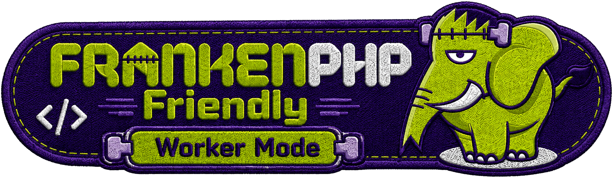
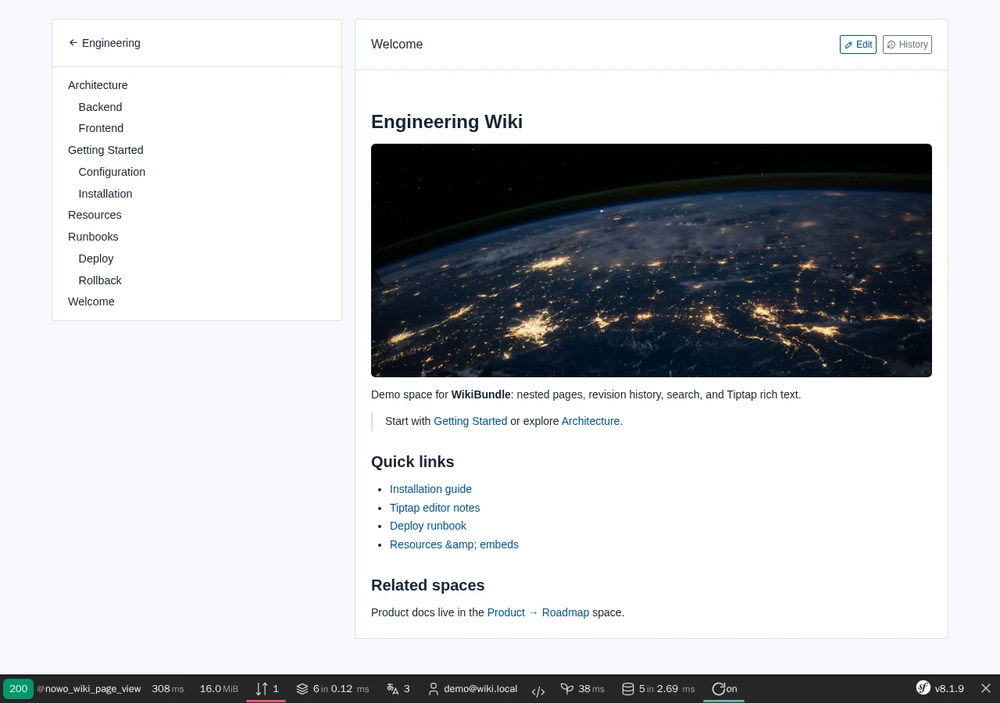
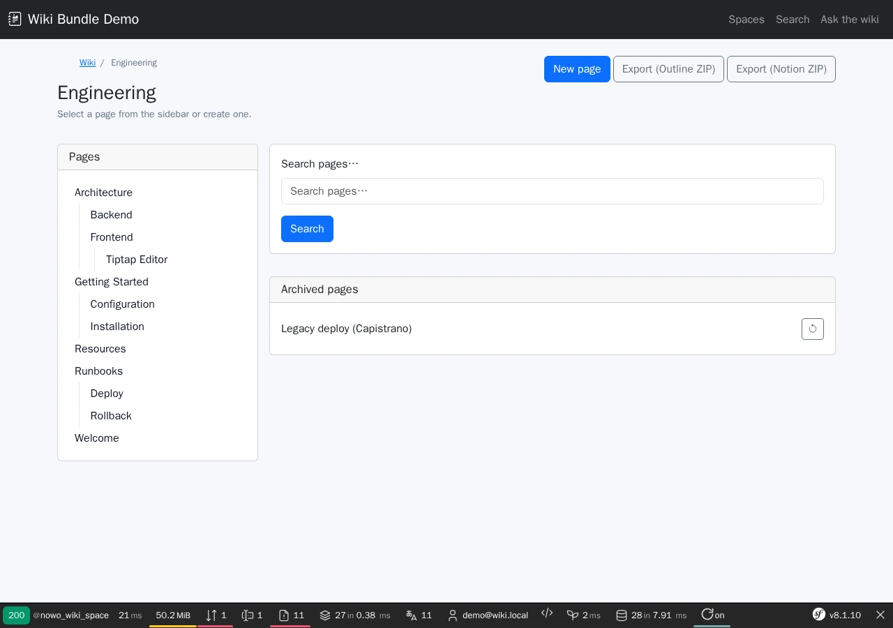
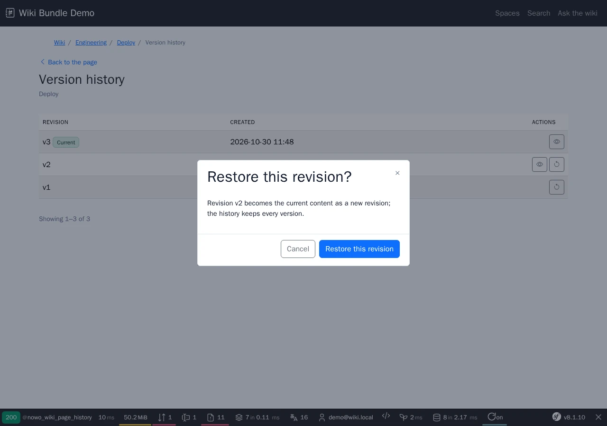

# Wiki Bundle

[](https://github.com/nowo-tech/WikiBundle/actions/workflows/ci.yml) [](https://packagist.org/packages/nowo-tech/wiki-bundle) [](https://packagist.org/packages/nowo-tech/wiki-bundle) [](LICENSE) [](https://php.net) [](https://symfony.com) [](https://github.com/nowo-tech/WikiBundle) [](#tests-and-coverage)

> ⭐ **Found this useful?** Give it a **star** on [GitHub](https://github.com/nowo-tech/WikiBundle) so more developers can find it.

Symfony bundle for a **versionable team wiki**: spaces, page trees, immutable revisions, diff, search, and Tiptap rich-text editing (Notion-like variant).

**FrankenPHP demos:** runtime is selected with **`FRANKENPHP_MODE`** (`worker` default, or `classic` for per-request PHP / hot-reload). See [docs/DEMO-FRANKENPHP.md](docs/DEMO-FRANKENPHP.md).



This bundle is **FrankenPHP worker mode friendly**, including kernel reset false (`FRANKENPHP_RESET_KERNEL=false`) and setups where the services resetter does not run (a host that removes or bypasses it, `messenger:consume --no-reset`, long-running commands): its request memos are emptied at every request, console and Messenger boundary, not only by `kernel.reset` (see [docs/FRANKENPHP-WORKER-AUDIT.md](docs/FRANKENPHP-WORKER-AUDIT.md)).

| Page view | Space home | Version history |
| --- | --- | --- |
|  |  |  |

## Features

- Wiki **spaces** scoped per team or user
- **Pages** with slug, parent/child tree, archive (revisions kept)
- **Immutable revisions** on every save
- **Revision diff** between any two versions
- Full-text **search** in title and current revision body (per space or all accessible spaces), with contextual excerpts
- **Import / export** — Outline and Notion Markdown trees (UI + `wiki:import` / `wiki:export` commands)
- **Symfony AI (optional)** — ask questions about wiki content with RAG context (`symfony/ai-bundle`)
- `WikiAccessCheckerInterface` + `WikiTeamMembershipResolverInterface` for app ACL
- **Standard Symfony and DDD / hexagonal hosts (1.33)** — attribute mapping, a Doctrine user and the 1.x ports by default; opt-in framework-free port twins, operations by id, XML mapping, users stored by id and a private entity manager for DDD hosts ([Architecture](docs/ARCHITECTURE.md), [Usage › DDD host](docs/USAGE.md#using-it-from-a-ddd--hexagonal-application))
- Pages on the **[UiKitBundle](https://github.com/nowo-tech/UiKitBundle) page contract** (list / show / form scaffolds, value-free view models, `<dialog>` confirm for Archive / Restore): the host themes them once with `nowo_ui_kit` — see [Templates](docs/TEMPLATES.md)
- CSRF on every POST action (the container refuses to compile without form CSRF protection)
- Integrates **[TiptapEditorBundle](https://github.com/nowo-tech/TiptapEditorBundle)** (`variant: notion` by default)
- **Markdown pages (optional)** — `editor.type: markdown` stores the Markdown source with a sanitized HTML cache, an extensible league/commonmark + GFM renderer and `wiki:convert-markdown` for existing pages ([Usage](docs/USAGE.md#markdown-pages-111))
- **Milkdown editor (optional)** — `editor.type: milkdown` with **[MilkdownEditorBundle](https://github.com/nowo-tech/MilkdownEditorBundle)**: page links, mentions, Tabler icons, callouts, math and Mermaid rendered per viewer under Milkdown's limits, and `wiki:convert-markdown --report` with a per-page fidelity report ([Usage](docs/USAGE.md#milkdown-editor-113))
- **Co-editing (optional)** — several people edit one Milkdown page at once over Mercure (`nowo_wiki.collaboration`): edit permission and a rate limiter on every request, a bounded Yjs log, reset only when needed ([Usage](docs/USAGE.md#co-editing-113))
- **Comments (optional, 1.16)** — inline and page comments in a right-side panel toggled from the page tabs (UiKit side panel, Milkdown 1.6 thread component), default-deny rights, live updates with co-editing, `nowo_wiki.comment.*` events ([Usage](docs/USAGE.md#comments-116))
- **Avatars (1.16)** — authors' pictures from a host resolver, only beside real names ([Configuration](docs/CONFIGURATION.md#avatars-116))
- **REST API (optional, 1.24)** — `nowo_wiki.api`: a JSON API for scripts and agents with the host's tokens: wikis, pages (Markdown in, the reader's Markdown out), saves from a known revision (409 on a stale one), revisions, search, comments and files, level ∩ access ∩ *where* on every request ([API](docs/API.md))
- **Plain-text search (1.16)** — the `content_text` column, so Markdown punctuation and directive attributes are never hits ([Configuration](docs/CONFIGURATION.md#search-text-116))
- Web UI options under `nowo_wiki.web_ui` (`enabled`, `path_prefix`, `layout_template`, `templates.<page>`) and roles per action under `nowo_wiki.security.roles`

## Installation

```bash
composer require nowo-tech/wiki-bundle nowo-tech/tiptap-editor-bundle
```

```yaml
# config/packages/nowo_wiki.yaml
nowo_wiki:
    user_class: App\Entity\User
```

See [Installation](docs/INSTALLATION.md).

## Demo

```bash
make -C demo/symfony8 up
# Demo started at: http://localhost:8025  →  /tools/wiki
make demo-smoke
```

The screenshots at the top of this README come from this demo; refresh them with `make -C demo/symfony8 demo-screenshots` (`make -C demo/symfony8 test-e2e` runs the Playwright happy path).

## Documentation

- [Installation](docs/INSTALLATION.md)
- [Configuration](docs/CONFIGURATION.md)
- [Usage](docs/USAGE.md)
- [Architecture: standard Symfony and DDD hosts](docs/ARCHITECTURE.md)
- [Templates (UiKit page contract)](docs/TEMPLATES.md)
- [REST API](docs/API.md) ([OpenAPI](docs/openapi.yaml))
- [Contributing](docs/CONTRIBUTING.md)
- [Code of Conduct](CODE_OF_CONDUCT.md)
- [Changelog](docs/CHANGELOG.md)
- [Upgrading](docs/UPGRADING.md)
- [Release](docs/RELEASE.md)
- [Security](docs/SECURITY.md)
- [Roadmap](docs/ROADMAP.md)
- [Engram](docs/ENGRAM.md)
- [Spec-driven development](docs/SPEC-DRIVEN-DEVELOPMENT.md)
- [GitHub Spec Kit](docs/SPEC-KIT.md)

### Additional documentation

- [PSR evaluation (REQ-CS-007)](docs/PSR.md)
- [GitHub Actions CI requirements](docs/GITHUB_CI.md)
- [Demo with FrankenPHP](docs/DEMO-FRANKENPHP.md)
- [Coverage gates and exclusions (REQ-TEST-003)](docs/COVERAGE.md)

## Tests and coverage

| Language | Coverage |
|----------|----------|
| PHP | **100%** — `make test-coverage` |
| TypeScript | **100%** — `make test-ts` (wiki assets) |

PHPUnit: **337 tests**. PHP coverage is enforced at 100% via `make test-coverage-100` / `composer test-coverage-100`; TypeScript coverage is enforced by the `vitest.config.ts` thresholds (100%). The few defensive `@codeCoverageIgnore` blocks are listed in [docs/COVERAGE.md](docs/COVERAGE.md).

## License

MIT — see [LICENSE](LICENSE).
